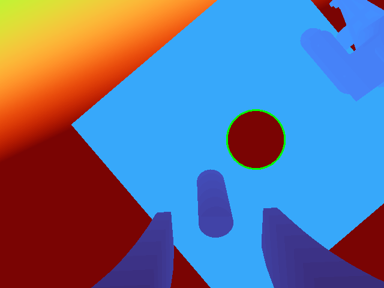

# 双 NERO 视觉戳洞 demo

左臂侧夹 **400 × 400 mm 方板**，板中心附近有约 **90 mm 圆孔**；右腕 D405 从深度图识别孔中心和法向，右臂持杆先对准孔前，再沿孔法向前送。底部保留 **280 mm 垫高**。

实机流程：**读取双臂反馈 → 估计观察位 → RViz 预览 → 输入 `do` → 相机看孔 → 必要时转腕 → 重新采集 → 孔前预览/执行 → 前送预览/执行**。左臂位置只用于估计相机观察位，最终孔位来自右腕深度检测。当前使用一次静止采集后规划，不是运动过程中持续更新目标的视觉伺服。

## 从哪里开始

| 目的 | 文档 / 入口 |
| --- | --- |
| 实机完整操作、预览后确认执行 | [实机流程](../../docs/real_hole_workflow.md) · `scripts/real_hole.sh` |
| Gazebo 中摆左臂、观察、穿孔、回退 | [仿真流程](../../docs/sim_hole_approach.md) · `scripts/sim_hole.sh` |
| 只接 USB，看识别效果 | `.venv-official/bin/python scripts/preview_d405_hole.py --serial 262422270020` |
| 左右夹爪控制 | `bash scripts/gripper.sh right close --force 0.5`（直接操作实物） |

所有命令在仓库根目录运行。现有 `scripts/` 入口保留，避免旧命令失效。仿真与实机使用不同入口和 ROS 域。

## 环境与构建

已使用 Ubuntu 22.04、ROS 2 Humble、MoveIt 2、Gazebo Classic 11、Python 3.10。系统需要 `python3-venv`、`python3-opencv`、colcon、ROS 的 MoveIt、ros2_control、ros2_controllers、Gazebo ROS 集成和 `image_tools`。其他包依赖见工作空间中的 `package.xml`。

先准备官方控制环境（下载依赖、编译，不启动机械臂）：

```bash
bash scripts/build_official_control.sh
.venv-official/bin/python -m pip install -r deps/hole_demo_requirements.txt
```

仿真额外构建：

```bash
source /opt/ros/humble/setup.bash
colcon --log-base sim_ws/log build --base-paths sim_ws/src \
  --build-base sim_ws/build --install-base sim_ws/install \
  --packages-up-to dual_nero_moveit_config
```

修改实机配置或预览桥后，重新构建对应包，使用同一仓库的 install：

```bash
source /opt/ros/humble/setup.bash
colcon --log-base hardware_ws/log build --base-paths hardware_ws/src \
  --build-base hardware_ws/build --install-base hardware_ws/install \
  --packages-select nero_dual_bringup
```

构建不会更新正在运行的节点；下次启动使用新版本。不要为更新 UI 而在实物运行时重复启动控制栈。

## 目录和数据

| 路径 | 用途 |
| --- | --- |
| `scripts/depth_hole.py` | 从 ArmHub 固定快照纳入的深度检测器；不再依赖外部 ArmHub 目录 |
| `scripts/real_hole_*.py` | 实机反馈、观察、孔坐标、目标、两段动作与预览管理 |
| `scripts/sim_hole_*.py` | 仿真观察、检测、规划、执行、原路回退 |
| `sim_ws/src/dual_nero_moveit_config/launch/hole_scene.py` | 方板、孔、杆和虚拟相机几何 |
| `hardware_ws/src/nero_dual_bringup` | 实机 ROS/MoveIt 接入、RViz 配置与预览转发器 |
| `config/handeye/right/d405.json` | 右腕手眼数据和相机序列号 |
| `config/handeye/left/d405.json` | 左腕手眼数据和相机序列号 |
| `sim_ws/validation/hole_approach/square_default/` | 方板默认位置的历史仿真记录 |
| `sim_ws/validation/hole_approach/square_offset_j1_003/` | 左臂 J1 偏移 0.03 rad 的历史仿真记录 |
| `hardware_ws/validation/real_hole/rviz_preview_issue/` | 旧起点预览问题的抓包对照 |

运行时实机 `observation.json`、`targets.json`、调试照片，以及仿真 `latest/`、`live/` 保留本地，已加入 `.gitignore`。仓库中的历史结果用于说明验证范围，不可直接作为新的执行计划。已有设备序列号及左右手眼标定数据保留上传。



上图为仿真深度识别记录。

## 已验证与限制

- 两次方板 Gazebo 记录的杆尖横向误差分别约 **2.48 mm**、**2.36 mm**，沿板中面法向前送结果约 **26 mm**；仅为对应仿真模型结果。
- 用户现场反馈实机大致流程已跑完；尚无独立测量的实机杆尖定位/穿孔精度报告。深度拟合 RMS、标定 RMS 均不等于最终工具精度。
- 实机规划先预览，终端输入 `do` 后执行；孔前和前送分别确认。`--plan-only` / `--preview-only` 只预览。
- 当前现场暂用杆尖法兰坐标 `(0, 0, 180) mm`、杆轴 `+Z`、直径 `16 mm`、穿过板面 `30 mm`，**是临时假设，未测量**。文档命令明确标注，换工具需更改。
- 实物板是近似碰撞场景，杆、相机碰撞体尚不完整；仿真固定夹持不代表实物摩擦夹持。右法兰模型与标定模型仍存在约 1 mm 几何差异，尚未完成全链路精度验收。
- 实机自动回退尚未实现；`sim_hole.sh retreat` 只用于仿真。

## 不连接硬件的回归检查

```bash
source scripts/official_control_env.sh
export ROS_DOMAIN_ID=91 ROS_LOCALHOST_ONLY=1
export CYCLONEDDS_URI="file://$PWD/config/cyclonedds_pointing.xml"
.venv-official/bin/python -m unittest discover -s scripts/tests -p 'test_depth_hole.py'
.venv-official/bin/python -m unittest discover -s scripts/tests -p 'test_real_hole*.py'
.venv-official/bin/python -m unittest discover -s scripts/tests -p 'test_sim_hole_scene.py'
```

测试覆盖合成深度孔、坐标变换、方板几何、当前状态显示、预览话题隔离以及 RViz Plan 有效消息转发，不会发 CAN 或执行轨迹。

本次整理的 [检查记录](validation.json)：27 项检查通过、两个相关 ROS 包构建通过；本次未重新执行实机或 Gazebo 全流程。
